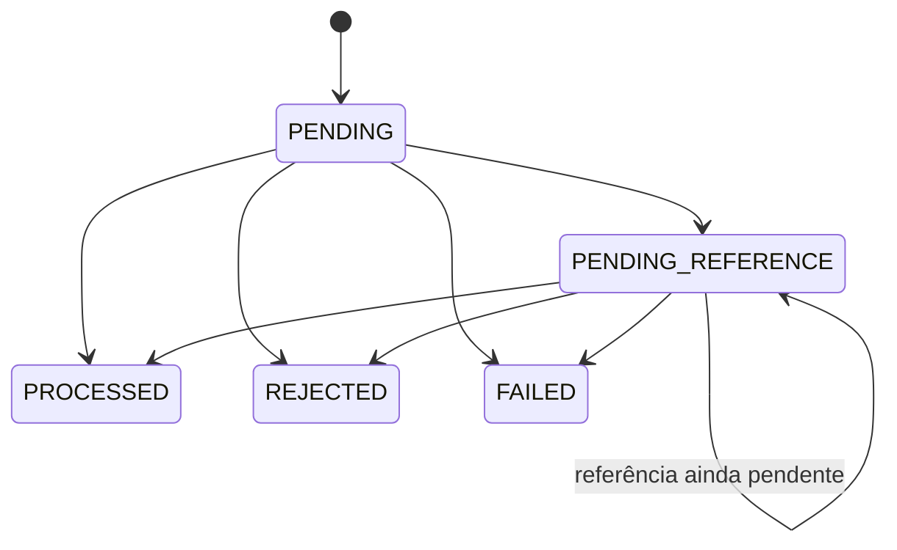

# Arquitetura da solução

## Estado e direção

A Fase 0 está concluída e a Fase 1 possui `Money`, `Wallet` e `WagerTransaction`. A direção é uma arquitetura hexagonal enxuta: domínio independente, casos de uso compartilhados por HTTP e SQS, adaptadores para entrada e persistência, e composição centralizada. Precisão monetária, invariantes da carteira e políticas de aposta estão implementadas em memória; as garantias transacionais e distribuídas ainda estão pendentes.

Dependências planejadas:

```text
HTTP / SQS -> aplicação -> domínio
PostgreSQL / mensageria -> contratos definidos pela aplicação
bootstrap -> composição dos componentes concretos
```

Não criamos interfaces, repositórios ou pastas vazias antes de seus casos de uso.

## Decisões implementadas na Fase 0

- **Go 1.27.2** fixado em `go.mod` e no estágio de compilação do Dockerfile; dependências registradas em `go.sum`.
- **Uber Fx 1.24.0** concentra injeção e lifecycle em `internal/bootstrap`. Módulos de configuração, logging e HTTP são compostos por construtores.
- **`net/http`** implementa o transporte em `internal/adapters/http`. O adaptador não depende de Fx. `cmd/server` apenas inicia a aplicação.
- **Configuração por ambiente**, validada antes da abertura do listener. Apenas opções utilizadas estão presentes em `.env.example`.
- **`slog` em JSON** recebe logs da aplicação, de Fx e erros internos do servidor HTTP.
- **Timeouts HTTP**: cabeçalhos em 5s, leitura em 10s, escrita em 15s e conexões ociosas em 60s.
- **Startup observável**: a abertura da porta acontece no `OnStart`, retornando erro ao Fx se falhar. Uma falha inesperada de `Serve` solicita encerramento com código 1.
- **Shutdown**: `SIGINT`/`SIGTERM` iniciam o `OnStop`; `Shutdown` interrompe novas conexões e aguarda requisições em andamento por até 10s. Se o prazo esgotar, `Close` força o fechamento. Fx tem orçamento total de 15s. O Docker deve conceder pelo menos 15s para parada.
- **Liveness público**: `GET /health/live` retorna `200` com `{"status":"ok"}`. Readiness depende da infraestrutura futura e não está exposto neste incremento.
- **Referência preservada**: o repositório oficial está clonado separadamente e uma cópia intacta do README é versionada em `docs/reference` com o SHA consultado.

Referências de composição: [servidor HTTP com Fx](https://uber-go.github.io/fx/get-started/http-server.html) e [lifecycle](https://uber-go.github.io/fx/lifecycle.html).

## Money — primeiro incremento da Fase 1

`internal/domain/money` usa apenas a biblioteca padrão. O valor guarda `cents int64` e `currency string` em campos privados. Soma, subtração e negação retornam novos valores, sem alterar os operandos. A cópia de um `Money` é independente. Não há setters nem conversão entre moedas.

**Moedas:** o tipo reconhece explicitamente `BRL` e `USD`, ambas com escala dois, para permitir comparação e testes reais de incompatibilidade entre valores válidos. Esta é uma precisão do plano inicial: a restrição BRL-only será da aplicação, ainda não implementada. Não aceitamos códigos arbitrários, minúsculos ou com espaços. Valores em moedas diferentes não podem ser somados, subtraídos, comparados ou considerados iguais; a operação retorna `ErrCurrencyMismatch`.

**Limites:** os valores internos vão de `-92233720368547758.08` a `92233720368547758.07`. Os construtores de entrada externa aceitam apenas a parte não negativa desse intervalo. `FromMinorUnits` aceita todo `int64`, inclusive diferenças negativas de reconciliação; ele não representa por si só a regra de saldo não negativo da futura carteira.

**Parsing e normalização:** `ParseDecimal` aceita dígitos ASCII, parte inteira obrigatória e parte fracionária opcional com uma ou duas casas. `1`, `1.0`, `1.00` e `0001.00` representam o mesmo valor; `FormatDecimal` devolve `1.00`. São rejeitados sinais (inclusive `-0.00` e `+1`), espaços, vírgulas, expoentes, NaN, infinito, `1.`, `.1` e escala excedente. Não há arredondamento. O parser acumula dígitos com checagem de limite antes de multiplicar e somar. O futuro hash de idempotência deverá usar essa representação canônica.

**Aritmética:** `Add` e `Sub` verificam overflow e underflow antes do cálculo. A subtração não nega o segundo operando, pois `MinInt64 - MinInt64` é válido mesmo que a negação isolada de `MinInt64` não seja. `Negate(MinInt64)` retorna erro. `Compare` usa comparação direta, sem subtração. A formatação cobre inclusive `MinInt64` sem tentar negá-lo diretamente.

**JSON:** `MarshalJSON` gera `amount` como string com duas casas e inclui `currency`. `ParseJSON` constrói um valor externo, exigindo strings e rejeitando campos desconhecidos e conteúdo adicional após o objeto. `json.Unmarshal` usa o mesmo construtor e só substitui o destino após validação completa; em erro, o valor anterior permanece intacto. Essa operação de decodificação é a exceção explícita à API de operações por valor. A serialização pode produzir negativos para resultados internos; o contrato de entrada continua rejeitando-os. A reidratação de diferenças negativas deve usar `FromMinorUnits`.

**Valor não inicializado:** `Money{}` é inválido. Use `Zero(currency)` para zero monetário. `Validate`, aritmética, comparação e serialização rejeitam o valor não inicializado. `MinorUnits` e `Currency` são apenas acessores; nas fronteiras da aplicação, valide antes de usá-los.

Erros classificáveis por `errors.Is`:

| Erro | Significado |
| --- | --- |
| `ErrInvalidMoney` | Valor não inicializado ou receptor nulo na decodificação |
| `ErrUnsupportedCurrency` | Código fora da lista suportada |
| `ErrInvalidAmount` | Formato decimal externo inválido |
| `ErrOverflow` | Parsing ou aritmética fora dos limites de `int64` |
| `ErrCurrencyMismatch` | Operandos em moedas diferentes |
| `ErrInvalidJSON` | Estrutura, tipos JSON, campos extras ou conteúdo adicional inválidos |

Erros dos campos em JSON preservam as classificações de moeda, formato e overflow. Os testes cobrem extremos numéricos, valores inválidos, normalização, moedas distintas, preservação dos operandos e contrato JSON. O fuzzing compara a aritmética com `math/big.Int` e o parsing aceito com `math/big.Rat`; essas bibliotecas são oráculos de teste, não a representação de produção.

## Wallet — segundo incremento da Fase 1

`internal/domain/wallet` encapsula UUID da carteira, UUID do jogador, saldo `Money`, versão `int64` e instantes de criação/atualização. A moeda é derivada do saldo, evitando dois campos que possam divergir. O agregado aceita as moedas suportadas por `Money`; a restrição de entrada a BRL continua reservada à futura aplicação.

**Identidade e relógio:** os construtores recebem IDs e horários; não geram identidades nem consultam `time.Now`. Usamos `github.com/google/uuid v1.6.0` como tipo de valor, rejeitando UUID nulo. A geração de UUID v7 ficará no caso de uso de criação. Essa biblioteca de identidade não introduz dependência de HTTP, Fx ou persistência no domínio. [Documentação do tipo UUID](https://pkg.go.dev/github.com/google/uuid@v1.6.0#UUID).

**Criação e reidratação:** `New` recebe saldo inicial não negativo, define versão 1 e ambos os timestamps no instante fornecido. `Rehydrate(State)` valida e copia um snapshot, preservando saldo e versão, sem reaplicar crédito nem gerar eventos. Ambos usam as mesmas validações de estado. Um saldo inicial positivo não incrementa versão; a futura abertura transacional terá de criar `OPENING`, ledger e outbox no mesmo commit. Isso ainda não é executado pelo agregado.

**Movimentações:** `Debit` e `Credit` recebem `Money` e horário. Rejeitam valor não inicializado, moeda incompatível, quantia negativa e horário inválido. Débito exige saldo suficiente; crédito usa a proteção de overflow de `Money`. Somente depois de todas as validações são atribuídos novo saldo, versão incrementada e horário de atualização. A versão não pode ultrapassar `MaxInt64`. Qualquer rejeição preserva o estado inteiro. Zero é aceito como operação sem efeito, inclusive na versão máxima, mas ainda exige moeda e horário válidos. A política de `LOSS` pertence à futura transação de aposta, não a este agregado.

**Tempo:** criação e atualização devem ser não nulos e atualização não pode anteceder criação. Movimentações aceitam o mesmo instante da última atualização, mas rejeitam instantes anteriores. Todos os horários são armazenados em UTC, preservando o instante recebido. Operações sem mudança de saldo preservam também `updatedAt`. A aplicação precisará fornecer uma fonte consistente de tempo para evitar regressões entre processos.

**Encapsulamento:** acessores e `Snapshot` retornam cópias. Alterar o snapshot ou decodificar JSON sobre uma cópia do saldo não altera a carteira. `Validate`, `Debit` e `Credit` rejeitam tanto `Wallet{}` quanto receptor nulo. Os acessores pressupõem instância construída e validada.

**Erros:** `errors.Is` distingue `ErrInvalidWallet`, `ErrInvalidIdentity`, `ErrNegativeBalance`, `ErrInvalidVersion`, `ErrInvalidTime`, `ErrNegativeAmount`, `ErrInsufficientFunds` e `ErrVersionOverflow`. Erros de moeda, valor monetário inválido e overflow preservam os sentinelas de `Money`. A tradução para códigos de aposta, incluindo insuficiência em reversões, será responsabilidade das políticas/casos de uso.

**Limites desta etapa:** uma instância do agregado pertence a uma execução de caso de uso e não deve ser compartilhada entre goroutines. Não há locks em memória nem garantia de concorrência distribuída neste pacote. Unicidade de `(player_id, currency)`, proteção contra lost updates e atomicidade com ledger/outbox dependem da próxima etapa de persistência. O teste de dois débitos sucessivos de 80 sobre 100 valida o saldo local; não substitui o cenário oficial concorrente com três processos.

Os testes exercitam criação zero/positiva, reidratação, estado inválido, moedas distintas, débito até zero, insuficiência, overflow monetário e de versão, timestamps e independência das cópias. O fuzzing executa sequências de movimentos contra um saldo calculado com `math/big.Int`, verificando preservação de estado em rejeições e atualização de versão em sucessos.

## WagerTransaction — terceiro incremento da Fase 1

`internal/domain/wagering` mantém o pedido, o estado, as datas, a referência interna resolvida, o código de falha e o resultado financeiro em estado privado. `Snapshot` e `Result` devolvem cópias, sem referências mutáveis ao agregado. IDs e horário são fornecidos pelo chamador.

**Entrada:** `NewExternal` exige IDs não nulos, provedor, ID externo, chave de idempotência, hash, rodada, jogo, tipo e `Money` válido. O hash deve ter o formato SHA-256 hexadecimal minúsculo; o cálculo canônico e a detecção de conflitos ainda não estão implementados e serão responsabilidade da aplicação. Ele nunca deverá ser confiado ao cliente. Campos textuais obrigatórios não podem ser vazios ou conter apenas espaços; não são normalizados silenciosamente.

`BET`, `WIN`, `REFUND` e `ROLLBACK` exigem valor positivo; `LOSS` exige zero. Quantias inválidas são erros de contrato (`ErrInvalidAmount`) antes de criar a transação. `REFUND`/`ROLLBACK` exigem referência; `WIN` permite referência opcional a BET. Referências em BET/LOSS, referências vazias compostas de espaços e autorreferência externa são rejeitadas como contrato inválido.

**Abertura:** `OPENING` é proibido no construtor externo. `NewOpening` recebe identidade, carteira, jogador e quantia sem os metadados externos. A origem interna é determinada por `Kind == OPENING`. Sua identidade estável deverá ser reutilizada pelo caso de uso e protegida por unicidade no banco. O domínio permite valor zero, mas a criação de carteira com zero deverá omitir OPENING, ledger e eventos financeiros. Ao processar uma abertura positiva, a carteira deve já conter exatamente esse saldo, versão 1 e instante de criação correspondente; não se credita novamente. Ledger de abertura e eventos serão criados na próxima etapa, com confirmação SQL posterior.

**Transições implementadas:**



`Process` é permitido somente em PENDING e PENDING_REFERENCE. PROCESSED, REJECTED e FAILED são terminais: uma nova chamada retorna `ErrInvalidTransition` sem alterar carteira ou transação. O futuro caso de uso de replay deverá devolver `Result`, sem chamar `Process` novamente. `Rehydrate` valida combinações de estado, resultado, referência e código sem executar movimentações. Datas são UTC e transições não aceitam instantes anteriores à última atualização.

**Processamento:** `Process(wallet, reference, at)` recebe dados já carregados pela aplicação. Ele valida carteira/jogador e trabalha sobre uma cópia da carteira. Apenas após validar o próximo estado da transação copia o saldo calculado para o agregado original. Erros retornados deixam ambos os agregados intactos. Rejeição de negócio é uma avaliação concluída: retorna `nil`, define REJECTED e `FailureCode`, preservando a carteira. O chamador deve sempre examinar `Status`; `nil` não significa necessariamente PROCESSED.

Quando uma carteira foi consultada, conclusões e rejeições guardam saldo/versão observados. Movimentos posteriores não alteram esse resultado. Uma rejeição por moeda incompatível guarda o saldo real na moeda da carteira. `Reject(code, at)`, usado por exemplo na expiração de referência, pode finalizar sem resultado financeiro quando não houve leitura da carteira; a API futura deverá representar essa ausência sem inventar um saldo zero.

**Referências:** são conferidos ID externo, provedor, carteira, jogador, moeda e rodada, além de impedir autorreferência interna. Não há uma restrição adicional de mesmo jogo: o enunciado exige mesma rodada. WIN e REFUND referenciam BET; ROLLBACK referencia BET, WIN ou REFUND. Referência ausente ou ainda pendente resulta em PENDING_REFERENCE sem efeito financeiro. Referência que terminou rejeitada/falha causa rejeição definitiva. WIN pode pagar valor diferente da aposta; REFUND e ROLLBACK exigem valor integral igual.

A [ADR 0001](docs/adr/0001-compensacao-direta.md) define uma única compensação direta bem-sucedida. `Reference.Compensated` representa uma consulta à persistência; não deve vir de HTTP/SQS. A referência original não é modificada. Falta implementar a coordenação SQL e o índice único que tornarão essa política segura entre processos.

**Movimentação:** BET debita; WIN e REFUND creditam; LOSS mantém inclusive versão e timestamp da carteira; ROLLBACK de BET credita; ROLLBACK de WIN/REFUND debita. Insuficiência na reversão tem código diferente da aposta. Overflow monetário é rejeição auditável. Estouro de versão ou estado inválido retorna erro sem efeitos; não é convertido automaticamente em falha de infraestrutura.

| Código persistível | Situação |
| --- | --- |
| `INSUFFICIENT_FUNDS` | BET sem saldo suficiente |
| `REVERSAL_INSUFFICIENT_FUNDS` | Reversão debitadora sem saldo |
| `REFERENCE_NOT_FOUND` | Prazo/tentativas esgotados, decidido pelo futuro worker |
| `REFERENCE_NOT_PROCESSED` | Referência terminou sem sucesso |
| `REFERENCE_SCOPE_MISMATCH` | Referência de outro escopo/ID ou autorreferência interna |
| `REFERENCE_AMOUNT_MISMATCH` | Compensação não integral |
| `INVALID_REFERENCE_KIND` | Tipo da referência incompatível |
| `ALREADY_REVERSED` | Referência já compensada diretamente |
| `WALLET_CURRENCY_MISMATCH` | Moeda da operação diferente da carteira |
| `BALANCE_OVERFLOW` | Crédito ultrapassaria o limite monetário |
| `PERMANENT_INFRASTRUCTURE_FAILURE` | Falha permanente explicitamente diagnosticada |

`FailPermanent` é uma transição explícita para FAILED. Falhas transitórias de PostgreSQL/SQS devem manter a operação passível de retry; este pacote não acessa infraestrutura nem classifica erros de I/O. A aplicação deverá distinguir essas situações antes de chamar a transição.

**Limites:** o processamento atual é de domínio em memória, sem ledger/eventos nem publicação. A aplicação terá de confirmar carteira, transação, ledger, inbox e outbox em uma única transação SQL. Não há ainda hash canônico, idempotência durável, contador de tentativas, deadline, backoff ou worker de referências. Reidratar uma pendência é testado; recuperação após reiniciar processos e banco continua pendente. Os agregados não devem ser compartilhados entre goroutines.

## Decisões previstas, ainda não implementadas

O plano mestre detalha as escolhas que serão confirmadas com código e testes:

- Lançamentos imutáveis de ledger e eventos tipados, incluindo os efeitos da abertura positiva.
- PostgreSQL com `pgx`, SQL explícito e transação única para estado financeiro, ledger, inbox e outbox; constraints protegendo invariantes.
- Coordenação por carteira entre processos; idempotência persistente e resultado original disponível para replay.
- Compensação direta única por transação, referências pendentes duráveis e retries limitados.
- Keycloak/OIDC, escopo por provedor e operações internas autorizadas.
- SQS com inbox, outbox após commit e recuperação de publicação com IDs estáveis.

Esses itens não estão concluídos. Migrations, ambiente Compose, endpoints de negócio, métricas e testes distribuídos serão acrescentados nas fases seguintes. O próximo incremento do domínio será ledger e eventos tipados.
