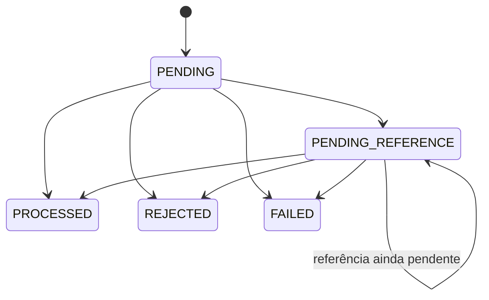

# Arquitetura da solução

## Estado e direção

O [enunciado oficial](docs/reference/README_DESAFIO.md) define os requisitos. A [matriz de conformidade](docs/CONFORMIDADE_DESAFIO.md) separa as garantias já demonstradas das pendências de integração e entrega; decisões arquiteturais devem respeitar esse contrato.

As Fases 0 e 1 estão concluídas: `Money`, `Wallet`, `WagerTransaction`, `WalletLedgerEntry` e os eventos tipados de domínio, com invariantes revisadas e verificadas. A Fase 2 está concluída: schema, pool, transações, abertura, leituras e reconciliação. A Fase 3 tem `ProcessWager` e a API HTTP autenticada por OIDC/Keycloak com evidência real. A Fase 4 está implementada: worker distribuído de referências pendentes com claim `SKIP LOCKED`, backoff e TTL (ver a seção dedicada). A Fase 5 já tem consumidor SQS/inbox, assinatura por provedor e integração LocalStack, e o publisher da outbox publica pós-commit com claim/lease, backoff e republicação com mesmo `eventId` (ver a seção dedicada). A direção é uma arquitetura hexagonal enxuta: domínio independente, casos de uso compartilhados por HTTP e SQS, adaptadores para entrada e persistência, e composição centralizada.

Dependências planejadas:

```text
HTTP / SQS -> aplicação -> domínio
PostgreSQL / mensageria -> contratos definidos pela aplicação
bootstrap -> composição dos componentes concretos
```

Não criamos interfaces, repositórios ou pastas vazias antes de seus casos de uso.

As seções por incremento preservam o histórico das decisões. A seção [ProcessWager](#processwager--processamento-transacional-compartilhado) registra as garantias atuais e supera as pendências históricas de processamento e idempotência.

## Decisões implementadas na Fase 0

- **Go 1.27.2** fixado em `go.mod` e no estágio de compilação do Dockerfile; dependências registradas em `go.sum`.
- **Uber Fx 1.24.0** concentra injeção e lifecycle em `internal/bootstrap`. Módulos de configuração, logging e HTTP são compostos por construtores.
- **`net/http`** implementa o transporte em `internal/adapters/http`. O adaptador não depende de Fx. `cmd/server` apenas inicia a aplicação.
- **Configuração por ambiente**, validada antes da abertura do listener. Apenas opções utilizadas estão presentes em `.env.example`.
- **`slog` em JSON** recebe logs da aplicação, de Fx e erros internos do servidor HTTP.
- **Timeouts HTTP**: cabeçalhos em 5s, leitura em 10s, escrita em 15s e conexões ociosas em 60s.
- **Startup observável**: a abertura da porta acontece no `OnStart`, retornando erro ao Fx se falhar. Uma falha inesperada de `Serve` solicita encerramento com código 1.
- **Shutdown**: `SIGINT`/`SIGTERM` iniciam o `OnStop`; `Shutdown` interrompe novas conexões e aguarda requisições em andamento por até 10s. Se o prazo esgotar, `Close` força o fechamento. Fx tem orçamento total de 15s. O Docker deve conceder pelo menos 15s para parada.
- **Liveness público**: `GET /health/live` retorna `200` com `{"status":"ok"}`. Readiness depende da infraestrutura futura e não está exposto neste incremento.
- **Referência preservada**: o repositório oficial está clonado separadamente e uma cópia intacta do README é versionada em `docs/reference` com o SHA consultado.

Referências de composição: [servidor HTTP com Fx](https://uber-go.github.io/fx/get-started/http-server.html) e [lifecycle](https://uber-go.github.io/fx/lifecycle.html).

## Money — primeiro incremento da Fase 1

`internal/domain/money` usa apenas a biblioteca padrão. O valor guarda `cents int64` e `currency string` em campos privados. Soma, subtração e negação retornam novos valores, sem alterar os operandos. A cópia de um `Money` é independente. Não há setters nem conversão entre moedas.

**Moedas:** o tipo reconhece explicitamente `BRL` e `USD`, ambas com escala dois, para permitir comparação e testes reais de incompatibilidade entre valores válidos. Esta é uma precisão do plano inicial: a restrição BRL-only será da aplicação, ainda não implementada. Não aceitamos códigos arbitrários, minúsculos ou com espaços. Valores em moedas diferentes não podem ser somados, subtraídos, comparados ou considerados iguais; a operação retorna `ErrCurrencyMismatch`.

**Limites:** os valores internos vão de `-92233720368547758.08` a `92233720368547758.07`. Os construtores de entrada externa aceitam apenas a parte não negativa desse intervalo. `FromMinorUnits` aceita todo `int64`, inclusive diferenças negativas de reconciliação; ele não representa por si só a regra de saldo não negativo da futura carteira.

**Parsing e normalização:** `ParseDecimal` aceita dígitos ASCII, parte inteira obrigatória e parte fracionária opcional com uma ou duas casas. `1`, `1.0`, `1.00` e `0001.00` representam o mesmo valor; `FormatDecimal` devolve `1.00`. São rejeitados sinais (inclusive `-0.00` e `+1`), espaços, vírgulas, expoentes, NaN, infinito, `1.`, `.1` e escala excedente. Não há arredondamento. O parser acumula dígitos com checagem de limite antes de multiplicar e somar. O futuro hash de idempotência deverá usar essa representação canônica.

**Aritmética:** `Add` e `Sub` verificam overflow e underflow antes do cálculo. A subtração não nega o segundo operando, pois `MinInt64 - MinInt64` é válido mesmo que a negação isolada de `MinInt64` não seja. `Negate(MinInt64)` retorna erro. `Compare` usa comparação direta, sem subtração. A formatação cobre inclusive `MinInt64` sem tentar negá-lo diretamente.

**JSON:** `MarshalJSON` gera `amount` como string com duas casas e inclui `currency`. `ParseJSON` constrói um valor externo, exigindo strings e rejeitando campos desconhecidos e conteúdo adicional após o objeto. `json.Unmarshal` usa o mesmo construtor e só substitui o destino após validação completa; em erro, o valor anterior permanece intacto. Essa operação de decodificação é a exceção explícita à API de operações por valor. A serialização pode produzir negativos para resultados internos; o contrato de entrada continua rejeitando-os. A reidratação de diferenças negativas deve usar `FromMinorUnits`.

**Valor não inicializado:** `Money{}` é inválido. Use `Zero(currency)` para zero monetário. `Validate`, aritmética, comparação e serialização rejeitam o valor não inicializado. `MinorUnits` e `Currency` são apenas acessores; nas fronteiras da aplicação, valide antes de usá-los.

Erros classificáveis por `errors.Is`:

| Erro | Significado |
| --- | --- |
| `ErrInvalidMoney` | Valor não inicializado ou receptor nulo na decodificação |
| `ErrUnsupportedCurrency` | Código fora da lista suportada |
| `ErrInvalidAmount` | Formato decimal externo inválido |
| `ErrOverflow` | Parsing ou aritmética fora dos limites de `int64` |
| `ErrCurrencyMismatch` | Operandos em moedas diferentes |
| `ErrInvalidJSON` | Estrutura, tipos JSON, campos extras ou conteúdo adicional inválidos |

Erros dos campos em JSON preservam as classificações de moeda, formato e overflow. Os testes cobrem extremos numéricos, valores inválidos, normalização, moedas distintas, preservação dos operandos e contrato JSON. O fuzzing compara a aritmética com `math/big.Int` e o parsing aceito com `math/big.Rat`; essas bibliotecas são oráculos de teste, não a representação de produção.

## Wallet — segundo incremento da Fase 1

`internal/domain/wallet` encapsula UUID da carteira, UUID do jogador, saldo `Money`, versão `int64` e instantes de criação/atualização. A moeda é derivada do saldo, evitando dois campos que possam divergir. O agregado aceita as moedas suportadas por `Money`; a restrição de entrada a BRL continua reservada à futura aplicação.

**Identidade e relógio:** os construtores recebem IDs e horários; não geram identidades nem consultam `time.Now`. Usamos `github.com/google/uuid v1.6.0` como tipo de valor, rejeitando UUID nulo. A geração de UUID v7 ficará no caso de uso de criação. Essa biblioteca de identidade não introduz dependência de HTTP, Fx ou persistência no domínio. [Documentação do tipo UUID](https://pkg.go.dev/github.com/google/uuid@v1.6.0#UUID).

**Criação e reidratação:** `New` recebe saldo inicial não negativo, define versão 1 e ambos os timestamps no instante fornecido. `Rehydrate(State)` valida e copia um snapshot, preservando saldo e versão, sem reaplicar crédito nem gerar eventos. Ambos usam as mesmas validações de estado. Um saldo inicial positivo não incrementa versão; a futura abertura transacional terá de criar `OPENING`, ledger e outbox no mesmo commit. Isso ainda não é executado pelo agregado.

**Movimentações:** `Debit` e `Credit` recebem `Money` e horário. Rejeitam valor não inicializado, moeda incompatível, quantia negativa e horário inválido. Débito exige saldo suficiente; crédito usa a proteção de overflow de `Money`. Somente depois de todas as validações são atribuídos novo saldo, versão incrementada e horário de atualização. A versão não pode ultrapassar `MaxInt64`. Qualquer rejeição preserva o estado inteiro. Zero é aceito como operação sem efeito, inclusive na versão máxima, mas ainda exige moeda e horário válidos. A política de `LOSS` pertence à futura transação de aposta, não a este agregado.

**Tempo:** criação e atualização devem ser não nulos e atualização não pode anteceder criação. Movimentações aceitam o mesmo instante da última atualização, mas rejeitam instantes anteriores. Todos os horários são armazenados em UTC, preservando o instante recebido. Operações sem mudança de saldo preservam também `updatedAt`. A aplicação precisará fornecer uma fonte consistente de tempo para evitar regressões entre processos.

**Encapsulamento:** acessores e `Snapshot` retornam cópias. Alterar o snapshot ou decodificar JSON sobre uma cópia do saldo não altera a carteira. `Validate`, `Debit` e `Credit` rejeitam tanto `Wallet{}` quanto receptor nulo. Os acessores pressupõem instância construída e validada.

**Erros:** `errors.Is` distingue `ErrInvalidWallet`, `ErrInvalidIdentity`, `ErrNegativeBalance`, `ErrInvalidVersion`, `ErrInvalidTime`, `ErrNegativeAmount`, `ErrInsufficientFunds` e `ErrVersionOverflow`. Erros de moeda, valor monetário inválido e overflow preservam os sentinelas de `Money`. A tradução para códigos de aposta, incluindo insuficiência em reversões, será responsabilidade das políticas/casos de uso.

**Limites desta etapa:** uma instância do agregado pertence a uma execução de caso de uso e não deve ser compartilhada entre goroutines. Não há locks em memória nem garantia de concorrência distribuída neste pacote. Unicidade de `(player_id, currency)`, proteção contra lost updates e atomicidade com ledger/outbox dependem da próxima etapa de persistência. O teste de dois débitos sucessivos de 80 sobre 100 valida o saldo local; não substitui o cenário oficial concorrente com três processos.

Os testes exercitam criação zero/positiva, reidratação, estado inválido, moedas distintas, débito até zero, insuficiência, overflow monetário e de versão, timestamps e independência das cópias. O fuzzing executa sequências de movimentos contra um saldo calculado com `math/big.Int`, verificando preservação de estado em rejeições e atualização de versão em sucessos.

## WagerTransaction — terceiro incremento da Fase 1

`internal/domain/wagering` mantém o pedido, o estado, as datas, a referência interna resolvida, o código de falha e o resultado financeiro em estado privado. `Snapshot` e `Result` devolvem cópias, sem referências mutáveis ao agregado. IDs e horário são fornecidos pelo chamador.

**Entrada:** `NewExternal` exige IDs não nulos, provedor, ID externo, chave de idempotência, hash, rodada, jogo, tipo e `Money` válido. O hash deve ter o formato SHA-256 hexadecimal minúsculo; o cálculo canônico e a detecção de conflitos ainda não estão implementados e serão responsabilidade da aplicação. Ele nunca deverá ser confiado ao cliente. Campos textuais obrigatórios não podem ser vazios ou conter apenas espaços; não são normalizados silenciosamente.

`BET`, `WIN`, `REFUND` e `ROLLBACK` exigem valor positivo; `LOSS` exige zero. Quantias inválidas são erros de contrato (`ErrInvalidAmount`) antes de criar a transação. `REFUND`/`ROLLBACK` exigem referência; `WIN` permite referência opcional a BET. Referências em BET/LOSS, referências vazias compostas de espaços e autorreferência externa são rejeitadas como contrato inválido.

**Abertura:** `OPENING` é proibido no construtor externo. `NewOpening` recebe identidade, carteira, jogador e quantia sem os metadados externos. A origem interna é determinada por `Kind == OPENING`. Sua identidade estável deverá ser reutilizada pelo caso de uso e protegida por unicidade no banco. O domínio permite valor zero, mas a criação de carteira com zero deverá omitir OPENING, ledger e eventos financeiros. Ao processar uma abertura positiva, a carteira deve já conter exatamente esse saldo, versão 1 e instante de criação correspondente; não se credita novamente. Ledger de abertura e eventos serão criados na próxima etapa, com confirmação SQL posterior.

**Transições implementadas:**



`Process` é permitido somente em PENDING e PENDING_REFERENCE. PROCESSED, REJECTED e FAILED são terminais: uma nova chamada retorna `ErrInvalidTransition` sem alterar carteira ou transação. O futuro caso de uso de replay deverá devolver `Result`, sem chamar `Process` novamente. `Rehydrate` valida combinações de estado, resultado, referência e código sem executar movimentações. Datas são UTC e transições não aceitam instantes anteriores à última atualização.

**Processamento:** `Process(wallet, reference, at)` recebe dados já carregados pela aplicação. Ele valida carteira/jogador e trabalha sobre uma cópia da carteira. Apenas após validar o próximo estado da transação copia o saldo calculado para o agregado original. Erros retornados deixam ambos os agregados intactos. Rejeição de negócio é uma avaliação concluída: retorna `nil`, define REJECTED e `FailureCode`, preservando a carteira. O chamador deve sempre examinar `Status`; `nil` não significa necessariamente PROCESSED.

Quando uma carteira foi consultada, conclusões e rejeições guardam saldo/versão observados. Movimentos posteriores não alteram esse resultado. Uma rejeição por moeda incompatível guarda o saldo real na moeda da carteira. `Reject(code, at)`, usado por exemplo na expiração de referência, pode finalizar sem resultado financeiro quando não houve leitura da carteira; a API futura deverá representar essa ausência sem inventar um saldo zero.

**Referências:** são conferidos ID externo, provedor, carteira, jogador, moeda e rodada, além de impedir autorreferência interna. Não há uma restrição adicional de mesmo jogo: o enunciado exige mesma rodada. WIN e REFUND referenciam BET; ROLLBACK referencia BET, WIN ou REFUND. Referência ausente ou ainda pendente resulta em PENDING_REFERENCE sem efeito financeiro. Referência que terminou rejeitada/falha causa rejeição definitiva. WIN pode pagar valor diferente da aposta; REFUND e ROLLBACK exigem valor integral igual.

A [ADR 0001](docs/adr/0001-compensacao-direta.md) define uma única compensação direta bem-sucedida. `Reference.Compensated` representa uma consulta à persistência; não deve vir de HTTP/SQS. A referência original não é modificada. Falta implementar a coordenação SQL e o índice único que tornarão essa política segura entre processos.

**Movimentação:** BET debita; WIN e REFUND creditam; LOSS mantém inclusive versão e timestamp da carteira; ROLLBACK de BET credita; ROLLBACK de WIN/REFUND debita. Insuficiência na reversão tem código diferente da aposta. Overflow monetário é rejeição auditável. Estouro de versão ou estado inválido retorna erro sem efeitos; não é convertido automaticamente em falha de infraestrutura.

| Código persistível | Situação |
| --- | --- |
| `INSUFFICIENT_FUNDS` | BET sem saldo suficiente |
| `REVERSAL_INSUFFICIENT_FUNDS` | Reversão debitadora sem saldo |
| `REFERENCE_NOT_FOUND` | Prazo/tentativas esgotados, decidido pelo futuro worker |
| `REFERENCE_NOT_PROCESSED` | Referência terminou sem sucesso |
| `REFERENCE_SCOPE_MISMATCH` | Referência de outro escopo/ID ou autorreferência interna |
| `REFERENCE_AMOUNT_MISMATCH` | Compensação não integral |
| `INVALID_REFERENCE_KIND` | Tipo da referência incompatível |
| `ALREADY_REVERSED` | Referência já compensada diretamente |
| `WALLET_CURRENCY_MISMATCH` | Moeda da operação diferente da carteira |
| `BALANCE_OVERFLOW` | Crédito ultrapassaria o limite monetário |
| `PERMANENT_INFRASTRUCTURE_FAILURE` | Falha permanente explicitamente diagnosticada |

`FailPermanent` é uma transição explícita para FAILED. Falhas transitórias de PostgreSQL/SQS devem manter a operação passível de retry; este pacote não acessa infraestrutura nem classifica erros de I/O. A aplicação deverá distinguir essas situações antes de chamar a transição.

**Limites:** o processamento atual é de domínio em memória, sem ledger/eventos nem publicação. A aplicação terá de confirmar carteira, transação, ledger, inbox e outbox em uma única transação SQL. Não há ainda hash canônico, idempotência durável, contador de tentativas, deadline, backoff ou worker de referências. Reidratar uma pendência é testado; recuperação após reiniciar processos e banco continua pendente. Os agregados não devem ser compartilhados entre goroutines.

## WalletLedgerEntry e eventos tipados — quarto incremento da Fase 1

`internal/domain/ledger` e `internal/domain/events` fecham a base de domínio da Fase 1 sem nenhuma dependência de infraestrutura.

**Ledger:** `Entry` é um tipo-valor imutável, como `Money`. Campos privados: identidade do lançamento, carteira, transação, direção (`DEBIT`/`CREDIT`), quantia, saldo anterior, saldo posterior e instante em UTC. Não há setters nem transições; por isso um único construtor serve tanto para criação quanto para reidratação. O construtor valida a exigência do enunciado: `balanceAfter = balanceBefore ± amount` conforme a direção, calculado com `Money.Add`/`Sub` (moeda e overflow checados); quantia obrigatoriamente positiva (LOSS e rejeições não geram lançamento); saldos não negativos; UUIDs não nulos; timestamp não nulo. Erros classificáveis por `errors.Is`: `ErrInvalidEntry`, `ErrInvalidDirection`, `ErrInvalidTime`, `ErrNonPositiveAmount`, `ErrNegativeBalance` e `ErrBalanceMismatch`, preservando os sentinelas de `Money`. O domínio não tem JSON próprio aqui: o DTO de leitura do ledger será do adaptador HTTP. Unicidade `(wallet_id, transaction_id)`, trigger contra `UPDATE`/`DELETE` e política contra `TRUNCATE` são responsabilidades do schema PostgreSQL (Fase 2).

**Eventos:** quatro tipos concretos — `WagerTransactionProcessed` (inclusive `LOSS` e `OPENING` interno), `WagerTransactionRejected`, `WalletBalanceChanged` e `WagerTransactionPendingReference`. `Envelope` é um tipo-valor imutável com `eventID`, `eventType`, `aggregateID`, `correlationID`, `causationID` opcional (`uuid.Nil` significa ausência; `CausationID()` devolve `(id, ok)`), `occurredAt` em UTC, `version` do payload por tipo (hoje 1) e `data` tipado. O `aggregateID` é **derivado dos dados** — transação nos eventos de transação, carteira em `WalletBalanceChanged` — portanto o envelope não pode divergir do payload; `Validate` confere essa coerência como defesa adicional. Kinds permitidos por evento: `Processed` aceita os seis (inclusive `OPENING`); `Rejected` apenas os cinco externos (`OPENING` nunca rejeita); `PendingReference` apenas `WIN`/`REFUND`/`ROLLBACK` (únicos que carregam referência externa). Regras de quantia por kind não são revalidadas aqui: quem emite o evento é um agregado que já as impôs; o evento valida estrutura, não política.

**WalletBalanceChanged:** o payload espelha o lançamento do ledger (`walletId`, `transactionId`, `direction`, `money`, `balanceBefore`, `balanceAfter`, `walletVersion`). O ID do lançamento não pertence ao evento, então não é possível reusar `ledger.Entry`; a invariante aritmética é revalidada localmente (poucas linhas, custo fixo) porque o evento inválido deve ser irrepresentável, não corrigido depois.

**JSON da outbox:** `Envelope.MarshalJSON` define agora o contrato do payload persistido em `outbox_events`: chaves `eventId`, `eventType`, `aggregateId`, `correlationId`, `causationId` (omitido quando ausente), `occurredAt` em RFC 3339 UTC, `version` e `data`, com dinheiro em string decimal via `Money.MarshalJSON`. Marshal valida o envelope e rejeita o valor zero. Não há `UnmarshalJSON`: o caminho de escrita é a outbox e a desserialização pertence aos consumidores.

**Limites desta etapa:** eventos são construídos em memória pelo futuro caso de uso; a gravação na `outbox_events` no mesmo commit SQL, o publisher com lease/backoff e a publicação somente após commit continuam pendentes. Os testes unitários cobrem construtores, kinds por evento, invariante de saldo em `WalletBalanceChanged`, envelope inconsistente e contrato JSON; cobertura de instruções: 100,0% em `ledger` e 95,0% em `events` (restam marcadores de interface e ramos internos de defesa). Nada aqui substitui os testes de integração com PostgreSQL real.

## Persistência — schema PostgreSQL (Fase 2, primeiro incremento)

Quatro migrations `up`/`down` em `migrations/` seguem a convenção do golang-migrate (runner ainda não integrado). Cada decisão do domínio tem contraparte no schema, e cada restrição foi verificada em container efêmero `postgres:17-alpine` com asserção do nome exato da constraint violada.

**Wallets:** `CHECK(balance_cents >= 0)`, `CHECK(version >= 1)`, moeda em lista explícita (`BRL`, `USD` — o schema aceita o que o domínio aceita; a restrição BRL-only da aplicação vem depois), `CHECK(updated_at >= created_at)` e índice único `(player_id, currency)`. Sem `DEFAULT` de horário: a aplicação fornece instantes UTC explícitos, coerente com os construtores do domínio.

**Wager_transactions:** a máquina de estados do domínio está codificada em `CHECK`s independentes — presença de `failure_code` é equivalente lógica a `status IN ('REJECTED','FAILED')`; resultado sempre em par (`result_balance_cents`/`result_wallet_version`) não negativo; `PROCESSED` exige resultado; `FAILED` proíbe; estados pendentes são puros (sem resultado, código ou referência resolvida); `OPENING` processado exige resultado igual à quantia com versão 1. Metadados externos são todos obrigatórios e não vazios para kinds externos e todos nulos para `OPENING`; `payload_hash` segue `^[0-9a-f]{64}$`; valor por kind (`LOSS` zero, externos positivos, `OPENING` não negativo); referência externa obrigatória em `REFUND`/`ROLLBACK`, proibida em `BET`/`LOSS`/`OPENING`, opcional em `WIN`; `reference_transaction_id` tem FK própria e proibição de autorreferência. Idempotência durável por dois índices únicos parciais (`(provider_id, idempotency_key)` e `(provider_id, external_transaction_id)` sobre origem externa); `UNIQUE(wallet_id) WHERE kind='OPENING'` impede crédito inicial duplicado; `UNIQUE(reference_transaction_id) WHERE kind IN ('REFUND','ROLLBACK') AND status='PROCESSED'` materializa a ADR 0001 (uma única compensação direta bem-sucedida, seja REFUND ou ROLLBACK); índice parcial por `next_attempt_at` serve o worker de referências.

**Ledger:** `UNIQUE(wallet_id, transaction_id)`, quantia positiva, saldos não negativos e `CHECK` aritmético por direção; soma além de `BIGINT` gera erro SQL no insert. Append-only por dois triggers: `BEFORE UPDATE OR DELETE` por linha e `BEFORE TRUNCATE` por statement, ambos levantando exceção. Isso bloqueia qualquer papel que não possa desabilitar triggers; a separação entre usuário de migração e usuário de runtime (sem `ALTER`/`DROP`/`TRUNCATE`/desabilitar trigger) vem com o ambiente Compose.

**Inbox e outbox:** inbox com `PRIMARY KEY(consumer_name, message_id)` e `CHECK(completed_at >= received_at)`; a conclusão compartilhará a transação SQL do tratamento. Outbox com tipos de evento válidos, `attempts >= 0`, `next_attempt_at NOT NULL` (evento nasce elegível), lease pareado (`leased_by`/`leased_until` juntos ou ausentes), índice parcial de pendentes por `next_attempt_at` e índice por `(aggregate_id, occurred_at)`.

**Verificação:** aplicação das quatro `up`, fluxo positivo completo e 41 blocos de violação (cada um afirma o nome da constraint que rejeitou), seguidos das quatro `down` deixando o schema vazio. Três casos têm proteções naturalmente sobrepostas (kind desconhecido também viola a regra de quantia; estado não terminal com código viola duas regras; direção desconhecida também viola a aritmética) e a asserção aceita qualquer uma delas — o PostgreSQL não garante ordem entre `CHECK`s.

**Pendências:** runner golang-migrate com alvos de Makefile e Compose; usuários distintos de migração e runtime; testes de integração Go com PostgreSQL real (o item de testar constraints/trigger do plano exige automação, não só verificação manual); repositórios e `UnitOfWork` com `pgx`.

## pgx — pool e UnitOfWork (Fase 2, segundo incremento)

`github.com/jackc/pgx/v5` (v5.11.0) com SQL explícito; `sqlc` e ORM ficam de fora. A primeira porta da aplicação vive em `internal/application/ports`: `UnitOfWork.WithinTx(ctx, fn)` — commit quando `fn` retorna nil, rollback em erro ou cancelamento, e **aninhamento que une à transação externa**. Um caso de uso e seus helpers compartilham sempre um commit; nenhuma função aninhada commita sozinha.

**Implementação (`internal/adapters/postgres`):** a `pgx.Tx` ativa viaja no `context`; repositórios futuros deste pacote a obtêm por `TxFromContext`, sem vazar `pgx` pela aplicação. O rollback usa `context.WithoutCancel` (cancelamento não pode impedir a limpeza) e o erro original do caso de uso é preservado — `errors.Is` do chamador continua funcionando; falha de rollback é agregada com `errors.Join`. Asserção de compile-time amarra o adaptador à porta. O pool é construído sem conectar (primeira conexão é lazy); `pgxpool.ParseConfig` valida a URL (aceita scheme `postgres://` e DSN keyword/value) — valores inválidos derrubam a inicialização. Padrões fixos: `MaxConnLifetime` 30m, `MaxConnIdleTime` 5m, `HealthCheckPeriod` 1m; contagem de conexões segue o padrão do pgxpool até o Compose definir dimensionamento por réplica sem esgotar `max_connections`.

**Composição:** `DATABASE_URL` é opcional nesta etapa — vazia, a aplicação sobe apenas com HTTP (não há endpoints de negócio); definida, o módulo `database` entra com ping de 5s no `OnStart` (banco inacessível impede o serviço de aceitar tráfego) e `Close` no `OnStop`. No Fx 1.24, `fx.New` executa os invokes na construção, então URL inválida falha já em `app.Err()`, antes de qualquer hook. O adaptador não importa Fx; hooks vivem no bootstrap, como no HTTP.

**Testes:** unitários cobrem parsing/config e o gate do módulo; os transacionais (commit, rollback por erro, rollback por cancelamento, aninhado une, erro interno derruba o externo) exigem PostgreSQL real, usam build tag `integration` e pulam sem `TEST_DATABASE_URL` — nenhum mock substitui o banco. **Retry de deadlock** (`40P01`/`40001` com limite e jitter) fica para o incremento do `ProcessWager`, onde reexecutar o caso de uso é seguro; o `UnitOfWork` atual nunca reexecuta `fn` por conta própria.

## Abertura atômica de carteira — caso de uso e repositórios (Fase 2, terceiro incremento)

`internal/application/command` nasce com `CreateWallet`, e `internal/application/ports` ganha as quatro portas de escrita: `WalletRepository`, `WagerTransactionRepository`, `LedgerRepository` e `OutboxRepository`. Elas recebem snapshots do domínio (não DTOs) e **exigem transação ativa** — os repositórios recusam escritas fora do `UnitOfWork`, codificando a regra "estado financeiro nunca commita sozinho".

**Casos de uso:** `CreateWallet` valida a entrada na fronteira da aplicação — BRL-only (o domínio aceita BRL/USD; a restrição da aplicação é permitida pelo enunciado), quantia não negativa e IDs não nulos. O saldo positivo grava, em um único commit: carteira versão 1, `OPENING` em `PROCESSED` (o agregado confirma o saldo existente — nunca credita duas vezes), lançamento de crédito 0→saldo e os eventos `WagerTransactionProcessed` + `WalletBalanceChanged` na outbox; o `causationId` de ambos é a transação de abertura. Saldo zero grava apenas a carteira, como o contrato exige. Identidades são UUID v7 com fallback v4 (entropia insuficiente não derruba o caso de uso; o requisito é unicidade) e o relógio é injetado.

**Repositórios:** SQL explícito com colunas nomeadas; a `pgx.Tx` vem do contexto. O mapeamento de erros é pelo par SQLSTATE + nome da constraint: `23505` em `wallets_player_currency_uidx` → `ports.ErrWalletAlreadyExists` (futuro 409). Metadados externos ausentes viram `NULL`; `HasResult` decide o par de colunas de resultado. O payload da outbox é o JSON imutável do envelope; `next_attempt_at` nasce igual a `occurred_at` (elegível imediatamente), `attempts` em zero.

**Harness de integração (`internal/testsupport`, tag `integration`):** cria o pool direto via `pgxpool` (não importa o adaptador, evitando ciclo de importação com os testes do próprio adaptador), aplica as migrations reais uma única vez por banco (`to_regclass('public.wallets')` como guarda — múltiplos binários de teste compartilham o schema sem recriá-lo) e nunca reseta dados: cada teste usa identidades únicas. Sem `TEST_DATABASE_URL` os testes pulam; com ela, nada é mockado.

**Testes:** unitários do caso de uso com fakes de orquestração (ordem das escritas, zero vs positivo, conflito interrompe antes das escritas financeiras, erro tardio propaga, entradas inválidas não tocam portas) — 83,6% de cobertura unitária; os fakes não substituem infraestrutura, só verificam orquestração, e a semântica transacional/SQL é toda da suíte de integração. Integração contra PostgreSQL real: abertura positiva persiste carteira + `OPENING` + ledger + 2 eventos; zero não gera nada financeiro; duplicata retorna `ErrWalletAlreadyExists` sem efeitos; **falha no meio do caso de uso (ledger injetado) faz rollback de tudo**; jogadores independentes recebem carteiras independentes. Cobertura `postgres`: 41,0% unitária / 55,1% com integração (ramos restantes são tradução de erros SQL ainda não exercitados). Nada ainda cobre concorrência entre processos — os cenários oficiais (duas apostas de 80, 50 duplicatas) exigem o `ProcessWager` e três instâncias.


## Leituras, cursor e reconciliação (Fase 2, quarto incremento)

`internal/application/query` agrega os casos de uso de leitura — `GetWallet`, `ListLedger` e `ReconcileWallet` — e `ports/queries.go` define as portas correspondentes (`WalletReader`, `LedgerReader`, `ReconciliationReader`), com `ErrWalletNotFound`, `ErrInvalidCursor` e `ErrLedgerSumOutOfRange` classificáveis para os futuros códigos HTTP.

**Leituras:** os readers se unem à transação do contexto quando existe uma (preparando o `SELECT ... FOR UPDATE` do futuro `ProcessWager`) ou usam o pool direto. Wallets reidratam pelo construtor do domínio — linha corrompida é erro, nunca aceitação silenciosa. Ledger pagina com cursor **opaco base64url** de `(created_at, id)`: ordenação estável com tie-break por uuid quando os timestamps coincidem, comparação por linha no PostgreSQL, `LIMIT n+1` para detectar próxima página e nenhum `OFFSET`. Cada entrada de ledger é reconstruída por `ledger.New`, revalidando a aritmética na leitura. A moeda vem por JOIN com a carteira: a tabela de ledger não tem coluna de moeda por decisão de schema, e o join impede adivinhação.

**Reconciliação:** transação `REPEATABLE READ READ ONLY` — saldo armazenado e soma do ledger saem do **mesmo snapshot**, imune a movimentos concorrentes, e o modo leitura garante que a reconciliação jamais altera o saldo (correções exigem novos lançamentos). A soma usa `SUM` em `NUMERIC` (não transborda) convertida com `math/big` e checagem de faixa antes de `FromMinorUnits`; um total fora do intervalo representável retorna `ErrLedgerSumOutOfRange` — falha auditable em vez de truncamento. `difference` é o saldo armazenado menos o reconstruído, podendo ser negativo (permitido em `Money` para diferenças).

**Proteções automatizadas:** os testes de integração agora exercitam em Go o trigger append-only (`UPDATE`, `DELETE` e `TRUNCATE` rejeitados, entrada intacta depois) e o `CHECK` de saldo negativo (SQLSTATE 23514), fechando o item 4 da Fase 2 que antes dependia só da verificação manual das migrations.

**Harness:** binários de teste diferentes correm em paralelo e disputavam a criação do schema; a aplicação das migrations agora ocorre sob `pg_advisory_xact_lock` com verificação `to_regclass`, dentro de uma transação — o schema aparece atomicamente e apenas uma vez. Os dados nunca são resetados (o trigger proíbe apagar o ledger), então os testes usam identidades únicas por execução; a suíte roda com `-count=2` no mesmo banco para provar isso.

## ProcessWager — processamento transacional compartilhado

`internal/application/command/process_wager.go` coordena as cinco operações externas através das portas existentes. O domínio continua responsável por valores, movimentos, rejeições e referências; o adaptador PostgreSQL executa SQL explícito. O módulo Fx da aplicação fornece `ProcessWagerDeps`, com teste de resolução do grafo. Não existe dependência de HTTP/SQS no caso de uso.

**Transação e concorrência:** a UnitOfWork abre uma transação READ COMMITTED. Primeiro procura as identidades por provedor. Sem replay, bloqueia apenas a linha da carteira com `SELECT ... FOR UPDATE`, consulta novamente a idempotência após a espera e avalia o domínio com o saldo atualizado. Atualiza saldo/versão usando também `WHERE version = expectedVersion`. Insere a transação, o lançamento apenas se houve movimento e os eventos na mesma transação SQL. LOSS e rejeições têm evento de resultado, mas não alteram saldo/versão nem criam ledger. Nenhum evento é publicado nesta etapa.

A ordem é carteira → leitura da referência → escritas. Referências são consultadas sem adquirir outro lock de carteira: somente referências da mesma carteira podem movimentar saldo, logo todos os escritores válidos dessa referência já estão serializados. O índice único de compensação direta reforça a regra. Carteiras distintas avançam independentemente; não existe mutex global na aplicação. O relógio é lido depois do lock, truncado a microssegundos e limitado inferiormente ao `updated_at` observado, evitando regressão por espera ou pequeno desvio entre relógios. Não se usa timestamp para decidir a ordem financeira: lock e versão fazem isso.

**Hash e identidades:** a aplicação calcula SHA-256, em hexadecimal minúsculo, do JSON UTF-8 de um DTO tipado, com chaves declaradas em ordem lexicográfica:

```text
amount, currency, externalTransactionId, gameId, kind, playerId,
providerId, referenceExternalTransactionId (quando presente), roundId, walletId
```

`amount` é uma string normalizada para duas casas por `Money.FormatDecimal`; UUIDs são strings canônicas. `json.Marshal` produz o documento compacto, com o escape padrão do Go (inclusive `<`, `>` e `&`); não há normalização Unicode, de caixa ou de espaços de identificadores. Textos inválidos em UTF-8 ou com NUL são recusados. Referência vazia é omitida. Chave de idempotência, correlation ID e metadados de transporte não participam do hash. Um vetor fixo independente verifica o digest; formas decimais equivalentes e alterações dos campos de negócio também são testadas. A implementação usa JSON ordenado deste contrato, sem afirmar conformidade geral com RFC 8785.

O futuro DTO HTTP/SQS deve converter ausência da referência para string vazia e rejeitar `null`, chaves repetidas e campos desconhecidos antes de chamar a aplicação. Esses parsers de transporte ainda não existem. Ambos usarão este mesmo cálculo; o cliente nunca fornece o hash confiável.

`(provider_id, idempotency_key)` com hash igual retorna o estado persistido; hash diferente retorna `ErrIdempotencyConflict`. `(provider_id, external_transaction_id)` sob outra chave também é conflito, sem criar aliases. Para operações terminais o resultado é o saldo/versão original, sem reprocessar regras e sem novas escritas. A aplicação permanece **BRL-only**, inclusive para carteiras acessadas pelo comando; domínio/schema continuam aceitando USD para testes de moeda. Assim, o resultado persistido e a moeda da operação não divergem.

**Retries:** o adaptador traduz SQLSTATE 40P01/40001 e 23505 somente dos dois índices de identidade para `ports.ErrRetryableTransaction`. O comando reexecuta toda a UnitOfWork, até quatro tentativas, com espera exponencial de base 25ms e jitter de até 25ms; o `context` interrompe a espera. Violações da outbox, checks, falhas de conexão ou commit ambíguo não são repetidos automaticamente. O chamador pode reenviar com a mesma identidade para consultar o resultado durável.

No futuro consumidor SQS, a UnitOfWork externa da inbox será dona do commit e do retry completo. O aninhamento apenas compartilha a transação; não deve tentar recuperar uma transação SQL abortada repetindo só o comando interno. Falhas transitórias não são convertidas em `FAILED` nem publicadas como rejeições de negócio.

**Referências:** ausentes ou ainda pendentes geram `PENDING_REFERENCE` e um evento durável sem ledger. Escopo, tipo, valor ou resultado terminal incompatível geram rejeição estável conforme o domínio. Replay de pendência apenas consulta o estado. `attempt_count`, `next_attempt_at` e `reference_deadline_at` continuam sem política operacional; TTL, claim, agendamento e retomada após reinício pertencem à Fase 4. Nenhuma migration existente foi alterada.

**Evidências:** PostgreSQL 17 real, sem substituto em memória: BET, WIN, LOSS, REFUND, ROLLBACK de BET/WIN/REFUND, insuficiência de saldo de reversão, conflitos, referências incompatíveis e pendentes; 50 duplicatas simultâneas; disputa 80+80 sobre 100; compensações concorrentes; disputa da mesma identidade entre carteiras diferentes; carteira independente avançando durante lock. Um erro SQL 23505 na segunda inserção da outbox verifica rollback inclusive do primeiro evento e permite nova execução limpa. Reconciliação confirma o saldo em cenários de concorrência e reversões. Trocar os readers verifica leitura durável, mas não equivale a reiniciar três processos. Esses testes distribuídos permanecem pendentes.

**Go e explicação para entrevista:** interfaces nas portas permitem que o comando dependa de operações necessárias, sem conhecer `pgx`. `context.Context` transporta cancelamento e, dentro do adaptador, a transação ativa. `%w`, `errors.Is` e `errors.As` preservam e classificam causas sem comparar mensagens. Snapshots são valores; cada chamada reidrata seus próprios agregados. Nos testes, goroutines iniciadas por um canal disputam conexões PostgreSQL e `sync.WaitGroup` aguarda a conclusão. Uma explicação curta: “O banco serializa operações por carteira; a chave única impede duplicações; saldo, ledger e eventos são confirmados juntos. O replay lê o resultado original, e a outbox permitirá publicar depois do commit.”

## API HTTP autenticada — OIDC/Keycloak e contratos da Fase 3

`internal/adapters/http` expõe os contratos oficiais; `internal/adapters/oidc` valida access tokens reais do IdP; `internal/application/ports/identity.go` define a fronteira de autenticação da aplicação (`Authenticator` → `Principal`). O domínio e os casos de uso não conhecem HTTP, tokens nem Fx.

**Validação de tokens (`oidc.Verifier`).** Descoberta OIDC no `OnStart` (falha antes de servir tráfego) e `RemoteKeySet` com cache e atualização quando uma assinatura usa chave nova (rotação do IdP). Somente **RS256**; `iss` e `aud` fixados na construção do verifier (a configuração exige issuer e audience não vazios); `exp` e `nbf` verificados pela biblioteca; adicionalmente exigimos `typ=Bearer`, `azp` presente e subject não vazio — tokens de outros tipos (ex.: ID tokens) não autenticam a API. A aplicação nunca emite tokens nem cadastra senhas: o realm `jungle` (`deployments/keycloak`) provisiona clientes `client_credentials` com mappers de audience (`jungle-api`), roles de realm e claim `provider_id` fixa por cliente. Segredos do realm são fictícios, apenas para desenvolvimento.

**Autorização.** `Principal` carrega apenas claims do token validado: subject, `provider_id` e roles de realm. `POST /wagering/transactions` exige role `provider` **e** `provider_id` não vazio; `GET /wagering/transactions/:id` e `GET /providers/:providerId/...` filtram sempre pelo provedor autorizado. As rotas de carteira (`POST /wallets`, leitura, ledger, reconciliação) exigem `wallet:manage`/`wallet:read` do serviço interno. O `providerId` do corpo/rota **nunca concede acesso**: divergência com a identidade é `403` antes de qualquer consulta ou efeito; consulta fora do escopo do provedor devolve `404` sem vazar existência. Replays, conflitos e respostas de erro seguem a mesma autorização — não existe caminho que retorne dados de outro provedor.

**Contrato de entrada.** Todo JSON de negócio passa por um decoder estrito (`json.go`): `Content-Type` exato, limite de 64 KiB, UTF-8 válido, varredura recursiva (profundidade máxima 8) que aceita **apenas objetos e strings** — números, booleanos e `null` são rejeitados na fronteira, portanto nenhum valor passa por `float64` —, chaves duplicadas (mesmo com caixa diferente) e campos desconhecidos são erro, e conteúdo extra após o objeto é recusado. Isso materializa o requisito de dinheiro em string sem arredondamento silencioso. `Idempotency-Key` é obrigatória, exatamente um header, e é usada como recebida — o servidor nunca a substitui por uma chave calculada. `X-Correlation-ID` opcional é validado como UUID não nulo e ecoado; ausente, é gerado e devolvido — toda resposta, inclusive erro, carrega `correlationId`.

**Respostas distinguíveis.** `201` abertura; `200` operação concluída (com `balance`, `walletVersion`, `idempotentReplay`); `202` pendência **sem saldo inventado**; `400` contrato inválido; `401` token ausente/malformado/assinatura alterada/expirado/audience errada (com `WWW-Authenticate`); `403` role ou provedor divergente; `404` recurso inexistente ou fora de escopo; `409` reuso de chave/ID externo com conteúdo divergente; `422` rejeição definitiva com `failureCode` estável (rejeições também têm replay idempotente); `503` indisponibilidade transitória sem commit — o cliente repete com a mesma chave e conteúdo e o servidor resolve pelo registro persistido. Cada request tem prazo de 10s via `context`. Corpos de erro trazem `error.code` estável, mensagem e `correlationId`; logs de falha registram `correlationId` e `providerId`, nunca tokens.

**Readiness.** `GET /health/ready` é público, registrado quando há dependências compostas: faz ping real no PostgreSQL com prazo de 2s e reporta apenas status (`ok`/`unavailable`) por dependência, sem detalhes internos. O check de SQS entra no mesmo registro com o módulo de mensageria (Fase 5). `/health/live` permanece de Fase 0.

**Composição.** O módulo `security` entra quando `OIDC_ISSUER` está configurado; `DATABASE_URL` passa a ser obrigatória (endpoints de negócio sem banco não fazem sentido). A ordem de startup no Fx é: ping do banco → descoberta OIDC → listener HTTP; o shutdown inverso drena HTTP antes de fechar JWKS/pool.

**Evidências reais (`api_integration_test.go`, tag `integration`).** O fixture sobe a aplicação Fx completa contra PostgreSQL e Keycloak reais (sem `TEST_OIDC_ISSUER` a suíte pula) e obtém tokens por `client_credentials`. Verificado: tokens ausente/malformado/assinatura alterada/audience errada → `401`; sem role e serviço interno em aposta → `403`; provedor B em identidade/rota/consulta/replay/conflito do provedor A → `403`/`404` sem efeitos financeiros (saldo, transações, ledger e outbox conferidos no banco); as cinco operações com replay histórico (saldo original preservado após WIN), LOSS sem ledger, REFUND+ROLLBACK, pendência `202` consultável; `409` nos dois conflitos de identidade; rejeição `422` com `INSUFFICIENT_FUNDS` e replay da rejeição; oito contratos inválidos → `400` sem efeitos; token expirado do IdP real (cliente com vida de 3s) → `401`; duas apostas de 80 sobre 100 concorrentes → uma `200`, uma `422`, saldo 20.00 e efeitos exatos no banco; readiness público → `200` com `postgres: ok`.

**Limites desta etapa.** Na conclusão da Fase 3 faltavam worker de referências e SQS, implementados nas seções seguintes. Publisher da outbox, métricas e a demonstração com três processos continuam pendentes; a concorrência HTTP é intra-processo (goroutines) com banco real. `GET /wagering/transactions/:id` exposto apenas ao provedor do registro; acesso interno autorizado a essa consulta, se necessário, será acrescentado com permissão explícita documentada.

## Worker de referências pendentes — Fase 4

`internal/application/command/retry_reference.go` e `internal/workers/references.go` retomam operações `PENDING_REFERENCE` de forma durável e distribuída. Nenhuma pendência depende da memória de um processo: o agendamento inteiro vive em `wager_transactions`.

**Claim.** `ClaimDuePendingReferences` (implementado pelo `WagerTransactionReader`) seleciona linhas `PENDING_REFERENCE` com `next_attempt_at` nulo ou vencido, `ORDER BY next_attempt_at NULLS FIRST LIMIT n FOR UPDATE SKIP LOCKED`, dentro da transação do reprocessamento. Duas instâncias nunca processam a mesma pendência: a segunda pula a linha travada em vez de esperar. A pendência recém-criada pelo `ProcessWager` nasce com `next_attempt_at` NULL — ou seja, elegível ao primeiro poll — sem que o INSERT do `ProcessWager` precise conhecer a política de retry.

**Ciclo por pendência (uma transação).** Claim → prazo: o deadline é `created_at + REFERENCE_TTL` (default 24h), materializado na primeira retomada e preservado nas seguintes. Esgotado → `Reject(REFERENCE_NOT_FOUND)` + evento `WagerTransactionRejected`, sem ler a carteira (nenhum resultado financeiro é inventado). No prazo → `LockWallet` (mesma serialização por carteira do `ProcessWager`), resolução da referência por `(provider_id, reference_external_transaction_id)` e `Process` sobre o agregado reidratado: `PROCESSED` persiste saldo/ledger/eventos exatamente como o fluxo síncrono (mesmo `transactionId`, sem nova identidade financeira); `REJECTED` persiste o código estável e o evento; ainda pendente → `attempt_count+1` e `next_attempt_at = now + backoff(attempt)` (exponencial 1s→5min), sem eventos — o evento de espera original já é durável.

**Transições de domínio.** O caminho reusa a máquina de estados (`PENDING_REFERENCE → PROCESSED | REJECTED | PENDING_REFERENCE`); o `UpdateWagerTransaction` reescreve apenas colunas mutáveis (estado, código, referência resolvida, resultado, timestamps, agendamento) — a identidade da operação é imutável. Reversões resolvidas continuam protegidas pelo índice único de compensação direta (ADR 0001): duas retomadas concorrentes da mesma referência não podem compensar duas vezes.

**Concorrência e falhas.** Deadlock/serialização repetem a transação inteira (limite e backoff do `ProcessWager`). Uma falha transitória qualquer rola back o claim: a pendência permanece elegível exatamente como antes — sem perda, sem meio-processamento. `attempt_count` cresce apenas em commits bem-sucedidos.

**Worker.** `ReferenceWorker.Run` faz polling por intervalo configurável (`REFERENCE_WORKER_INTERVAL`, default 1s) com lotes de até 50; erro de lote é logado e o próximo tick retenta. O loop recebe um `context`: cancelamento interrompe novos polls e aborta o lote em andamento (rollback → pendências voltam a ficar elegíveis para qualquer instância). `Run` só retorna depois do lote em andamento terminar — shutdown observável. O `Retry` é injetado como **method value** (`retry.RetryDueReferences`): o loop depende de uma função, não de um tipo concreto, sem criar interface artificial. No bootstrap, o `OnStop` do worker roda antes do close do pool (ordem reversa de registro do Fx), e a suíte HTTP sobe/derruba a aplicação completa com o worker ativo.

**Eventos de retomada.** Correlation e causation dos eventos emitidos na retomada carregam o `transactionId` persistido: o correlation original do request não vive na linha da transação, e a operação retomada é tanto a causa quanto a unidade de rastreio da conclusão.

**Evidências (PostgreSQL 17 real, `-race`).** Reagenda com `attempt_count=1` e `next_attempt_at` futuro; resolve após a BET chegar (saldo 100−25+25=100.00, versão 3, três lançamentos de ledger, referência resolvida gravada); rejeita por TTL com evento de rejeição e carteira intacta; dois workers concorrentes retomam 8 pendências exatamente uma vez cada (soma de tentativas 8, nenhuma carteira movida); falha transitária no agendamento rola back e a mesma pendência é reivindicada com sucesso na chamada seguinte. Unitários cobrem reagenda, resolução, expiração sem acesso à carteira, referência rejeitada, lote vazio e retry de deadlock; o worker cobre cancelamento, defaults e sobrevivência a erro de lote. A suíte HTTP (Keycloak real) sobe e encerra a aplicação Fx completa com o worker no lifecycle.

## Trabalho ainda pendente

- Revisão final de entregáveis (eliminatórias, `.env.example`, secrets, README consolidado).

As seções anteriores registram a evolução por incremento; as garantias atuais do processamento estão descritas acima. A entrega completa continua pendente.


## Falhas literais — Fase 6, incremento 4

`scripts/fault.sh` executa os Testes E/F/H como drills contra o Compose de
entrega, fechando o que a integração determinística comum não cobre: um
processo morto de verdade no meio do fluxo.

**Design do drill.** O comando `docker compose kill -s KILL api` mata as três
réplicas de uma vez; como todas disputam a mesma fila, o momento exato da
morte (antes do receive, durante o processamento, após o commit e antes do
delete, ou depois do delete) não é previsível — e é justamente essa a
proposição: em qualquer ponto de morte, recomeçar leva ao mesmo resultado
financeiro, decidido pela identidade persistente (índices únicos, inbox e
referência no banco), nunca pela memória do processo. `up -d api` devolve as
réplicas com retry dentro da espera de saúde (a recuperação de contêiner morto
às vezes exige repetir `up -d` mesmo com a configuração inalterada).

**Asserções e custos.** Toda verificação é por HTTP com tokens reais: saldo,
contagem de lançamentos do ledger, status da operação por ID externo e
reconciliação de snapshot. O produtor assinante (`cmd/send-wager`) fala com o
LocalStack publicado apenas em loopback; a fila é resolvida via
`get-queue-url`, pois o esquema de URL do LocalStack muda entre versões.

**Aprendizados registrados:** dois erros de identidade descobertos pela
política do domínio ao construir o script — player divergente da carteira
(`ErrWalletScope`, DLQ permanente) e rodada divergente entre REFUND e BET
(pendência reagendando indefinidamente em vez de concluir); ambos comprovam a
validação de escopo e moldaram o drill (identidades casadas exatamente). O
"not observed in flight" acontece quando a mensagem é consumada antes da
janela de observação; o canal de voo determinístico já está coberto pelos
failpoints de integração.


## Métricas financeiras — Fase 6, incremento 3

`/metrics` serve um registro Prometheus dedicado (`observability.Prometheus`,
deliberadamente sem métricas de runtime Go). Conjuntos são singletons por processo:
`sync.Once` impede o duplo registro de construtor repetido (bootstrap, testes).

**Financeiros:** `jungle_wager_operations_total{kind,status}` conta cada resposta
do caso de uso concluída no handler HTTP — um replay idempotente também é uma
resposta com status persistido, contada como operação e adicionalmente em
`jungle_wager_idempotent_replays_total`; conflitos de identidade viram
`jungle_wager_idempotency_conflicts_total` (409). A duração por kind vai no
histograma `jungle_wager_processing_duration_seconds{kind}`. Retries de
transação do `ProcessWager` alimentam `jungle_wager_db_retries_total{reason}`
(o rótulo é limitado: `retryable_transaction`; classificação por SQLSTATE
específica fica posterior). No consumidor SQS,
`jungle_wager_sqs_redeliveries_total` conta mensagens com
`ApproximateReceiveCount > 1` e `jungle_wager_dlq_total` cada cópia à DLQ. Na
reconciliação interna, `jungle_wallet_reconciliations_total` conta execuções e
`jungle_wallet_reconciliation_divergences_total` marca divergências (o saldo
nunca é corrigido; o log JSON já existente persiste a diferença).

**Outbox:** contadores por processo (`claim/publish/failures/retries/lease`) e
os gauges `jungle_outbox_pending`/`jungle_outbox_oldest_age_seconds` como um
`Collector` que consulta o PostgreSQL a cada scrape — falha de consulta aparece
como métrica inválida na saída, nunca como zero velho.

**Rótulos:** apenas kind, status e reason, todos enumerados e limitados para
não permitir cardinalidade explosiva — identidade de jogador/carteira/provedor
nunca vira rótulo; o correlationId permanece só nos logs JSON.

As seções anteriores registram a evolução por incremento; as garantias atuais do processamento estão descritas acima. A entrega completa continua pendente.


## Compose de entrega e três processos — Fase 6, incremento 2

**Composição.** `docker-compose.yml`, projeto `jungle-delivery`: `postgres` 17,
job `migrate` (o mesmo binário do runner com `entrypoint` próprio, esperando o
banco saudável), `keycloak` 26.8 com o realm importado e healthcheck na porta
de management 9000, `localstack` SQS 4.14.0, três réplicas do serviço `api`
(`deploy.replicas`, cada uma um processo com pool próprio e healthcheck
`/health/live`) e um `gateway` nginx 1.27 publicado apenas em loopback
(`9080`), junto ao IdP (`59080`).

**Ordem de partida.** `postgres` saudável → `migrate` aplica o schema completo
e termina com código zero → réplicas iniciam, bloqueadas por `keycloak` e
`localstack` saudáveis (a inicialização da app faz discovery OIDC e provisiona
filas). Assim nenhuma réplica consulta um esquema anterior às migrations.

**Gateway.** O `nginx.conf` resolve o upstream por request com `resolver
127.0.0.11` e `set $upstream http://api:8080`: o DNS do Docker rodas entre os
IPs das réplicas, sem o truque de IP fixado de um bloco `upstream` estático
(que sofre o cache do nginx na resolução inicial). `X-Request-ID` adicional
para correlação local.

**Issuer.** `KC_HOSTNAME=http://keycloak:8080` faz tokens e `jwks_uri` apontarem
para o nome interno, resolvível pelas réplicas; a máquina hospedeira obtém
tokens pela porta publicada sem conhecer esse hostname. Essa divisão de issuer
URL pública vs endereço interno é a variação de desenvolvimento prevista no §6.2
e não muda a validação estrita do `iss`.

**Smoke (`scripts/smoke.sh`).** Reproduz o cenário oficial: token
`client_credentials` real, abertura de 100.00, 50 BETs idênticas concorrentes
via gateway com uma única processada (o resto replays com resultado armazenado),
par concorrente distinto com 200/422, saldo final exato, três lançamentos e
reconciliação consistente. Contrato respeitado: a chave de idempotência existe
apenas no header `Idempotency-Key`; o body não a carrega (decoder estrito).
Logs por container mostram a distribuição (21/18/13 requisições nas réplicas).

**Evidências.** `down -v` + `up --build` a partir de limpo, réplicas healthy em
~1min, smoke aprovado, `/metrics` acessível pelo gateway e encerramento com
remoção de volumes/redes. Limites: kill literal de containers nos pontos
críticos e a suíte de integração de falhas continuam pendentes (Fase 6).


## Runner de migrations — Fase 6, incremento 1

`cmd/migrate` é o único dispositivo autorizado a alterar o schema. Usa
`golang-migrate/v4` com o driver `pgx5` (a biblioteca `pgx/v5` já presente no
módulo fornece a conexão) e fonte `iofs` sobre `migrations/`.

**Comandos:** `up [N]` aplica pendentes, `down N` reverte N (destrutivo,
explicito, sem padrão), `version` imprime a versão registrada ou `none`, e
`force V` registra uma versão sem executar SQL — usado para adotar um banco cujo
schema foi criado pelo harness de testes. `ErrNoChange` é tratado como
"história já no alvo", e a versão dirty falha com instrução de inspeção.

**Conexão:** `DATABASE_URL` obrigatório; o prefixo `postgres://`/`postgresql://`
vira `pgx5://` por substituição de prefixo, preservando todos os parâmetros
(incluindo `sslmode`) sem re-parsear a URL. Um ping curto com `context` falha
rápido com o erro real de conexão antes do golang-migrate abrir seu próprio
pool. O driver faz advisory lock interno, então dois `migrate` concorrentes não
aplicam a mesma migration duas vezes.

**Operação:** `Makefile` expõe `migrate-up`, `migrate-down N=` e
`migrate-version`; o Dockerfile constrói `bin/migrate` e copia `migrations/`
para o mesmo binário servir de job do Compose final. Cada migration é um único
`Exec` multi-assertion implícito do PostgreSQL; uma interrupção no meio pode
deixar a versão dirty — recuperação documentada por `force` após inspeção.

**Verificação:** a integração real cria e descarta um banco temporário por
execução, sem tocar dado de desenvolvimento: ciclo completo
`up` → versão 4 limpa, `up` repetido no-op, `down`/`up` parciais alternando
versões e rollback total com histórico vazio; no banco de desenvolvimento,
`up` recusou reaplicação do schema pré-existente e `force 4` adotou o estado
sem tocar dados.


## Outbox publisher — Fase 5, incremento 2

**Fronteira e composição.** `PublishOutboxDeps` (`internal/application/command`) orquestra
claim, envio e confirmação; `internal/workers.OutboxWorker` drena até 50 claims por tick
com cancelamento observável e passa a função tipada (method value) — sem interface
artificial. `internal/adapters/postgres.OutboxDeliveryRepository` executa cada operação
SQL por si só e `internal/adapters/sqs.EventPublisher` publica na fila de eventos; o
comando não conhece nem `pgx` nem o SDK AWS. Bootstrap compõe tudo no módulo messaging.

**Claim.** `INSERT ... RETURNING` invertido em CTE: `SELECT ... FOR UPDATE SKIP LOCKED`
sobre eventos `published_at IS NULL` e elegíveis (`next_attempt_at <= clock_timestamp()`,
lease ausente ou vencido), seguido de `UPDATE` que grava `leased_by`, `leased_until` e
incrementa `attempts` (saturado em SQL int max). `clock_timestamp()` evita desvio de
relógio entre hosts. O token (`leased_by`) identifica **o claim, não o processo**: um
lease vencido não pode confirmar nem reagendar, mesmo que o mesmo processo o readquira
depois — Republicação só vem de um claim novo e legítimo.

**Envio e confirmação.** Entre o claim e o ack **não há transação nem lock de linha
abertos**: a chamada de rede SQS usa `MessageDeduplicationId=eventId` e
`MessageGroupId=aggregateId` sobre o payload `payload_json` do banco (snapshot imutável;
nenhum evento é regenerado em retry). `MarkPublished` grava `published_at` condicionado
ao token e ao lease vigente; falha na confirmação é recuperável pelo vencimento do lease.
`ScheduleRetry` grava `next_attempt_at` com backoff exponencial 1s→5min (expoente
limitado, sem overflow de `time.Duration`) e `last_error`, sempre condicionado ao token.
O evento nunca é descartado: tentativas são ilimitadas com atraso limitado.

**At-least-once explícito.** Falha após envio e antes do ack deixa o evento recuperável:
a próxima instância reenvia o **mesmo `eventId` e payload**. A deduplicação FIFO do broker
suprime a repetição na janela, mas a garantia direcionada ao consumidor externo é
deduplicar pelo `eventId` além da janela — a entrega nunca é prometida exatamente uma vez.
No shutdown, cancelamento interrompe I/O e o comando libera leases conhecidos com cleanup
limitado (`context.WithoutCancel`), para que trabalho conhecido não fique preso até o
vencimento.

**Métricas.** `/metrics` expõe contadores por processo (`jungle_outbox_claimed_total`,
`published_total`, `publish_failures_total`, `confirmation_failures_total`,
`retries_total`, `lease_lost_total`) e gauges consultados no PostgreSQL na hora
(`jungle_outbox_pending`, `jungle_outbox_oldest_age_seconds`); falha de consulta responde
503, nunca atraso falso. Sem labels de alta cardinalidade.

**Evidências.** PostgreSQL 17 e LocalStack reais, `-race`, filas e schema isolados por
teste: claim exclusivo com incremento; ack/reschedule com token alheio →
`ErrOutboxLeaseLost`; lease abandonado recuperado com `attempts=2` e liberado apenas pelo
token novo; reschedule grava `PUBLISH_FAILED` e respeita backoff; entrega com corpo
idêntico ao snapshot, dedup `eventId` e grupo `aggregateId`; crash simulado entre envio e
confirmação recuperado com o mesmo `eventId` (janela FIFO suprime a repetição);
quatro publishers concorrentes entregam dois eventos uma única vez cada. Kill literal de
processo e três instâncias permanecem para a Fase 6.


## Entrada SQS/inbox — Fase 5, incremento 1

**Fluxo e fronteiras.** O adaptador SQS traduz o envelope oficial para
`ConsumeWagerMessage`, que chama o mesmo `ProcessWager` do HTTP. `jsonx.Decode`
centraliza o decoder estrito: UTF-8, strings/objetos, sem `null`, campos desconhecidos,
chaves duplicadas ou números JSON; limite de 64 KiB no envelope e identidade
não vazia de até 256 bytes. Domínio e aplicação continuam independentes do SDK.
Fx compõe cliente, consumidor e portas; o loop recebe uma função tipada (method
value), sem interface criada apenas para invocar um método.

**Atomicidade.** `ConsumeWagerMessage` abre a UnitOfWork externa; a UnitOfWork de
`ProcessWager` encontra a transação no contexto e a reutiliza sem commit próprio.
O fluxo financeiro ocorre antes do `INSERT ... ON CONFLICT DO NOTHING` na inbox.
Na colisão, hash e transação vinculada precisam coincidir e `completed_at` precisa
existir; conflito devolve erro e desfaz TODAS as escritas financeiras daquela
tentativa. A chave primária `(consumer_name, message_id)` decide corridas entre
instâncias. Não há cache de deduplicação em memória nem dependência do FIFO para
integridade. Deadlock/serialização são classificados pela UnitOfWork externa,
que faz rollback antes de repetir tudo (máximo quatro tentativas SQL). `25P02`
isolado não autoriza retry: a causa original precisa chegar ao dono da transação.

**Dois hashes.** A inbox guarda SHA-256 dos bytes exatos do envelope. Mesmo
`messageId` com espaços/conteúdo diferentes é conflito. A operação usa o hash
canônico de negócio já compartilhado com HTTP; IDs/correlação/timestamps de
transporte não modificam sua idempotência. Duplicatas com novos envelopes podem
ter inboxes distintas, mas retornam a única transação financeira persistida.

**Identidade do produtor.** Atributos SQS não constituem identidade confiável.
`providerId` e `signature` transportam HMAC-SHA256 de
`jungle-wager-v1\0 + providerId + \0 + corpo bruto`. `SQS_PROVIDER_KEYS` vincula cada
provedor à sua chave; `hmac.Equal` compara assinaturas em tempo constante, e o
provedor autenticado deve corresponder ao corpo antes de consultar/reexecutar
operações. O CLI recebe só a chave daquele produtor. Chaves não entram nos logs,
na inbox ou na outbox. O corpo oficial permanece igual. São chaves fictícias de
desenvolvimento, sem rotação automática: remoção/troca exige coordenar mensagens
pendentes. O broker local exposto em loopback não demonstra IAM de produção;
implantação real exigiria configuração de credenciais/IAM, gestão de chaves e
controle de acesso à fila. HTTP mantém OIDC/Keycloak externo.

**Entrega e falhas.** `DeleteMessage` sucede o commit; `PENDING_REFERENCE` já
persistido pode concluir a inbox. Um erro de commit com resultado desconhecido
não é interpretado como rollback ou sucesso: não confirma a mensagem, que volta
pelo broker. A reentrega com mesma identidade resolve o registro durável e não
movimenta novamente. Teste injeta perda da resposta APÓS um commit PostgreSQL
real e exige replay da inbox e da operação. Rejeições de negócio confirmadas são
terminais. Erros de contrato/autorização/conflito vão diretamente à DLQ por
send-then-delete, preservando corpo e atributos; ID de deduplicação da DLQ deriva
do ID de transporte original. Se send ou delete falhar, a origem pode reaparecer;
a cópia na DLQ também tem semântica at-least-once, nunca exactly-once.

**Fila e prazos.** Provisionamento reconcilia FIFO/redrive/visibilidade;
`maxReceiveCount=3`, visibilidade 30s e deduplicação por conteúdo desligada.
O produtor agrupa por carteira e usa SHA-256 do corpo como dedup ID. Poll espera
10s (request limitado a 15s); um item por receive evita lote local envelhecer
invisível; processamento/ack limitado a 10s. Falhas transitórias usam
`ChangeMessageVisibility` com 1s/2s/4s; o broker faz redrive após três recebimentos.
Sem resposta dessa chamada, a visibilidade original limita a recuperação.
Provisionamento tem deadline real de 30s; readiness verifica as três filas com
o deadline da rota. SDK Go v2 usa endpoint explícito e credenciais locais.

**Shutdown.** Fx para HTTP, cancela consumidor/workers e só depois fecha o pool.
Cancelamento interrompe polling/processamento; SQL não confirmado é revertido.
Receipt conhecido tem visibilidade liberada com contexto independente limitado
a 2s. Um receive cancelado antes de entregar seu receipt pode ter sido aceito
pelo broker: a mensagem reaparece em até 30s. O teste aguarda essa janela e soma
mensagens visíveis, invisíveis e atrasadas para não inferir ack pela ausência de
mensagens visíveis. Shutdown com SQL em andamento verifica rollback real e
reentrega imediata do receipt conhecido.

**Evidências.** PostgreSQL 17, Keycloak 26.8.0 e LocalStack Community 4.14.0 reais.
Suítes exercitam aposta/duplicata, rejeição terminal, pendência, envelope inválido,
assinatura ausente/provedor forjado, conflito na inbox com rollback financeiro,
CHECK da inbox falhando e redrive após três tentativas, falha após commit,
resposta de commit perdida, shutdown, reconciliação de políticas existentes e
readiness 503 por fila removida. HTTP autenticado e SQS executam mesma aposta nas
duas ordens e concorrentemente: saldo 75, versão 2, duas transações/dois lançamentos
(abertura + BET), quatro eventos e reconciliação consistente.

**Limites.** Testes usam filas exclusivas e excluem só recursos próprios. Falhas
são injetadas em fronteiras reais do commit; não substituem interrupção literal
de processos. Fila de eventos provisionada não significa publisher implementado.
Métricas, dois publishers, reinícios, três processos e Compose de entrega ficam
para os próximos incrementos.
