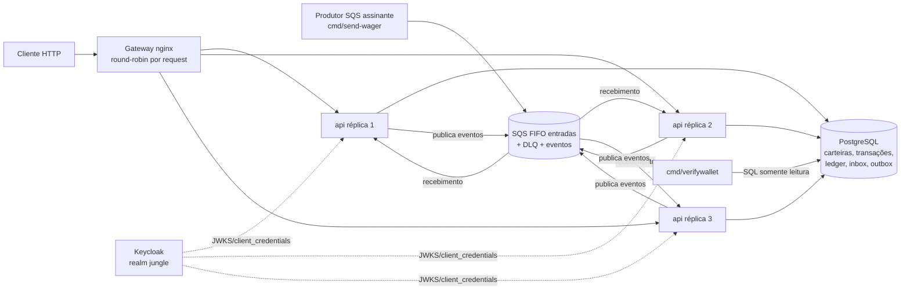

# Arquitetura em diagramas (Mermaid)

> Diagramas refletem o sistema implementado (não aspiracional). Fonte:
> `docker-compose.yml`, `internal/bootstrap/*`, workers e migrations.

## 1. Containers



## 2. Fluxo HTTP de BET

```mermaid
sequenceDiagram
  participant C as Cliente (provedor A)
  participant G as Gateway
  participant S as IdP (Keycloak)
  participant R as api réplica
  participant PG as PostgreSQL
  C->>S: client_credentials → access token
  C->>G: POST /wagering/transactions (JWT, Idempotency-Key)
  G->>R: round-robin
  R->>S: verificação JWKS (iss/aud/exp/nbf/typ/azp, role, provider_id)
  R->>PG: BEGIN; identidade (índices únicos provider,key / provider,external)
  alt replay/conflito
    R->>PG: SELECT resultado armazenado (sem novos efeitos)
    R-->>C: 200 (idempotentReplay) | 409 (conflict)
  else nova operação
    R->>PG: SELECT wallet FOR UPDATE (lock por linha)
    R->>PG: aplica regra (débito/crédito/loss), insere ledger, grava transação + outbox
    R->>PG: COMMIT
    R-->>C: 200 PROCESSED (saldo do resultado) ou 422 REJECTED (persistida)
  end
```

## 3. Fluxo SQS/inbox

```mermaid
sequenceDiagram
  participant P as Produtor autorizado
  participant Q as SQS wager-transactions.fifo
  participant R as api réplica (consumidor)
  participant PG as PostgreSQL
  P->>Q: envelope assinado (HMAC provider)
  Q->>R: ReceiveMessage (long polling)
  R->>R: valida envelope/assinatura/providerId
  R->>PG: BEGIN (UnitOfWork); inbox (consumer, messageId) hash
  R->>R: ProcessWager (mesmo caso de uso do HTTP, mesma tx)
  R->>PG: COMMIT (carteira+transação+ledger+outbox+inbox.completed)
  R->>Q: DeleteMessage (só após commit)
  Note over Q,R: crash após commit antes do delete?<br/>reentrega resolve como replay da inbox
```

## 4. Transactional outbox

```mermaid
graph LR
  T[Transação financeira] -- mesmo commit --> O[(outbox_events<br/>payload imutável)]
  W1[worker publisher 1<br/>rmplica 1] -- claim SKIP LOCKED + lease/token --> O
  W2[worker publisher 2] -- claim --> O
  W3[worker publisher 3] -- claim --> O
  W1 -- SendMessage<br/>dedup eventId, group wallet --> EVQ[(SQS wager-events.fifo)]
  W2 -- SendMessage --> EVQ
  W3 -- SendMessage --> EVQ
  W1 -- ack published_at (token vigente) --> O
  Note: crash após send e antes do ack<br/>→ outra instância republica o MESMO eventId
```

## 5. Concorrência entre três réplicas

```mermaid
graph TD
  subgraph réplicas
    R1[api-1 (pgxpool 24 conns)]
    R2[api-2 (pgxpool 24)]
    R3[api-3 (pgxpool 24)]
  end
  G[Gateway nginx] --> R1 & R2 & R3
  DB[(PostgreSQL<br/>mas 72 conn total < max 100)]
  R1 --> DB
  R2 --> DB
  R3 --> DB
  DB -->|SELECT ... FOR UPDATE por carteira| DB
  DB -->|índices únicos provider+key / provider+external| DB
  DB -->|SKIP LOCKED claims de pendências/outbox via leases| DB
```

## 6. Recuperação após falhas

```mermaid
stateDiagram-v2
  [*] --> OperaçãoRecebida
  OperaçãoRecebida --> AntesCommit: qualquer crash
  AntesCommit --> [*]: rollback; nada persistido
  OperaçãoRecebida --> Commit
  Commit --> PósCommitAntesDelete: crash (SQS nome)
  PósCommitAntesDelete --> OperaçãoRecebida: reentrega → replay inbox (mesma identidade)
  Commit --> EventoOutbox
  EventoOutbox --> PósSendAntesAck: crash do publisher
  PósSendAntesAck --> EventoOutbox: outra instância republica o MESMO eventId
  EventoOutbox --> Publicado: ack com token vigente
  Publicado --> [*]
  OperaçãoRecebida --> ReferênciaAusente
  ReferênciaAusente --> PENDING_REFERENCE: worker retoma com SKIP LOCKED
  PENDING_REFERENCE --> Processado: referência chega
  PENDING_REFERENCE --> REJECTED: TTL vencido (REFERENCE_NOT_FOUND)
```


