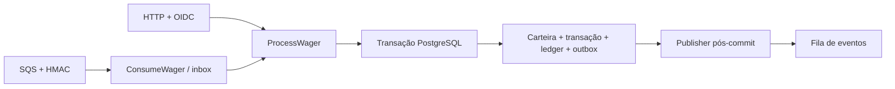

# Guia de entrevista — Jungle Backend Go

## Apresentação em um minuto

“Construí um processador financeiro em Go com HTTP e SQS usando o mesmo caso
de uso. PostgreSQL é a fonte da verdade: cada movimento confirma carteira,
transação, ledger, outbox e, no consumo SQS, inbox juntos. O banco coordena as
réplicas por carteira. Reentregas consultam a identidade persistida e não
movimentam novamente. Demonstrei concorrência com três processos, autenticação
Keycloak real e SIGKILL em janelas controladas. O ambiente LocalStack Community
ainda tem limitações comprovadas de autorização e persistência; não confundo
HMAC com IAM nem uma outbox publicada com recuperação do armazenamento do broker.”

## Arquitetura e escolhas

- **Domínio:** Money, Wallet, WagerTransaction, ledger e eventos tipados. Campos
  privados, construtores validados e snapshots por valor; sem Fx, SQL ou SDK AWS.
- **Aplicação:** casos de uso e interfaces pequenas para persistência/publicação.
  HTTP e SQS chegam ao mesmo ProcessWager; validações financeiras são compartilhadas.
- **Adaptadores:** net/http, OIDC, pgx com SQL explícito e SDK AWS SQS.
- **Bootstrap:** Uber Fx compõe os construtores e gerencia OnStart/OnStop.

Go e Fx são obrigatórios no desafio. Go também oferece tipos estáticos,
interfaces pequenas, context para cancelamento, testes/race detector e binário
simples de distribuir. Goroutines ajudam no I/O, mas não coordenam processos:
locks e índices do PostgreSQL fazem isso. Fx torna o grafo e a ordem de
encerramento verificáveis; o domínio continua sem depender do framework.

Escolhemos PostgreSQL porque saldo, ledger, identidade e eventos precisam de
um único commit ACID. Constraints são uma defesa adicional ao domínio, e o SQL
explícito torna locks, isolamento e condições de atualização revisáveis.

## Fluxo financeiro que você deve saber desenhar

A transação verifica idempotência, bloqueia a carteira com `FOR UPDATE`,
verifica identidade novamente após a espera, aplica o domínio e persiste as
escritas. A atualização também exige a versão esperada. Carteiras diferentes
bloqueiam linhas distintas; não há lock global. Duas BET de 80 sobre 100
terminam em uma processada, uma rejeitada, saldo 20 e um débito.

Money usa centavos `int64`; o JSON carrega strings decimais. Parsing e aritmética
verificam escala, moeda e overflow. O agregado impede saldo negativo e o banco
reforça com CHECK. Ledger é append-only: correção exige novo lançamento.

## Perguntas prováveis e respostas naturais

**Como 50 chamadas iguais produzem um débito?**
A identidade é persistida com índices únicos por provedor/chave e provedor/ID
externo. Um hash SHA-256 do contrato de negócio distingue replay de conflito.
Depois de esperar o lock, o perdedor consulta novamente a identidade. Replay
devolve o resultado original, inclusive o saldo daquele instante.

**HTTP e SQS calculam hashes diferentes?**
O hash financeiro usa o mesmo JSON tipado, com campos ordenados, dinheiro
normalizado e UUID canônico. Exclui chave de idempotência e transporte. A inbox
usa outro hash: os bytes exatos do envelope, para detectar messageId reescrito.

**Por que inbox além da idempotência da aposta?**
A inbox identifica o tratamento de uma mensagem por consumidor e messageId.
Ela grava conclusão e transação vinculada no mesmo commit financeiro. A
identidade da aposta protege duplicatas entre canais e envelopes diferentes;
a inbox protege a identidade do envelope recebido.

**E se morrer depois do commit e antes do DeleteMessage?**
A visibilidade vence e a mensagem reaparece. A inbox e a transação já existem;
a reentrega resolve como replay, sem novo débito, e então remove a mensagem.
O ensaio E matou processos nesse ponto e verificou SQL, reentrega e saldo.

**A outbox garante exatamente uma publicação?**
Não. Ela garante uma intenção durável e publicações pós-commit com retry.
O publisher usa claim/lease; se morrer após SendMessage e antes do ACK no
banco, outro processo recupera o evento após a lease vencer. Reenvia os mesmos
bytes/eventId. O consumidor externo também precisa deduplicar por eventId.

**Por que o token da lease muda a cada claim?**
Um publisher antigo não pode confirmar uma lease já vencida e adquirida por
outro. O UPDATE de ACK exige o token atual e prazo vigente. O token identifica
a tentativa de posse, não apenas a máquina.

**O que FIFO resolve?**
Agrupa mensagens de entrada por carteira e reduz duplicatas dentro da janela
de deduplicação do SQS. Não substitui constraints, inbox ou idempotência em
banco. O sistema assume at-least-once mesmo usando FIFO.

**Quando uma mensagem vai para a DLQ?**
Contrato, assinatura ou identidade inválidos são erros permanentes: cópia à
DLQ seguida de delete somente após confirmação. Falhas transitórias mantêm a
mensagem e usam backoff; após três recebimentos o redrive do broker atua.
Rejeição financeira é resultado terminal auditável, não erro técnico para DLQ.

**Como tratam REFUND antes da BET?**
Persistimos PENDING_REFERENCE sem movimentar saldo. Um worker distribuído
reivindica pendências com SKIP LOCKED, tenta a referência e grava backoff/TTL.
A chegada posterior resolve no mesmo transactionId; expiração gera rejeição
REFERENCE_NOT_FOUND e evento. O relógio é atualizado depois do lock e respeita
o updated_at persistido; o TTL é reavaliado após a espera.

**Pode haver REFUND e ROLLBACK devolvendo a mesma BET duas vezes?**
Não. A política documentada na ADR 0001 permite uma única compensação direta
bem-sucedida da referência. Um índice parcial reforça essa política. ROLLBACK
de um REFUND pode desfazer o crédito desse REFUND, respeitando saldo suficiente.

**O race detector prova segurança distribuída?**
Não. Ele detecta acessos concorrentes indevidos à memória do processo. A prova
distribuída exige múltiplos processos com conexões próprias, PostgreSQL real,
duplicatas concorrentes e falhas. A entrega tem esses dois níveis de evidência.

**O que acontece quando o resultado do commit é desconhecido?**
Não suponho rollback nem sucesso. O cliente reenvia a mesma identidade; no SQS
não removo a mensagem. O registro durável decide se houve commit e resolve o
replay sem aplicar a movimentação outra vez.

**Readiness impede novos requests quando o broker cai?**
Ela informa 503. O gateway local não aplica automaticamente esse sinal como
bloqueio de tráfego. HTTP pode confirmar operações no PostgreSQL e deixar a
outbox pendente; depois o publisher retoma. Liveness só indica processo vivo.

**Métricas são contabilidade?**
Não. São observações por processo, sem garantia durável: SIGKILL após commit
pode perder um incremento. Replays são separados de novos resultados; cópia
à DLQ só é contada após envio aceito. Auditoria financeira consulta saldo,
ledger, transações e outbox em snapshot consistente.

**Por que REPEATABLE READ no verificador?**
Várias consultas READ COMMITTED poderiam observar instantes diferentes,
criando uma divergência falsa durante escritas. O verificador SQL e a
reconciliação usam snapshots consistentes de leitura, sem corrigir o saldo.

**Como a autorização funciona?**
HTTP valida tokens do Keycloak por issuer, audience, validade e assinatura;
provider_id vem do token. Roles restringem carteiras ao serviço interno.
SQS valida HMAC por produtor e compara sua identidade com o corpo. IAM deve
proteger acesso às filas separadamente: o LocalStack usado não aplicou a
negação nos ensaios e os templates de papéis ainda não estão ligados a clientes
separados no runtime.

## Limitações e próximos passos de produção

O broker local perdeu filas e mensagens aceitas após restart mesmo com volume
e PERSISTENCE=1. A outbox com published_at **não republica automaticamente**
esses eventos. O ensaio de indisponibilidade pré-ACK comprovou recuperação;
o de perda posterior comprovou uma limitação. Não alegar conformidade integral.

O provisionamento já tem comando próprio; consumidor e publisher usam clientes
SDK com perfis independentes. Antes de produção: validar IAM real com esses
papéis; usar broker durável e testar negações por identidade; separar usuário
SQL de migrations do runtime (Compose local usa o mesmo usuário administrativo);
gerenciar/rotacionar chaves e tokens, usar TLS, testar backup/restauração e
monitorar DLQ/redrive e métricas de cada réplica. Testar comportamento de
consumidores externos diante de eventos repetidos ou fora de ordem também é
necessário. Esses itens não foram apresentados como entregues.

Não há partidas dobradas, tracing distribuído ou dashboard: são opcionais.
O relatório de carga distingue campanhas históricas e a regressão atual;
um ensaio curto não será apresentado como soak de 15 minutos.
